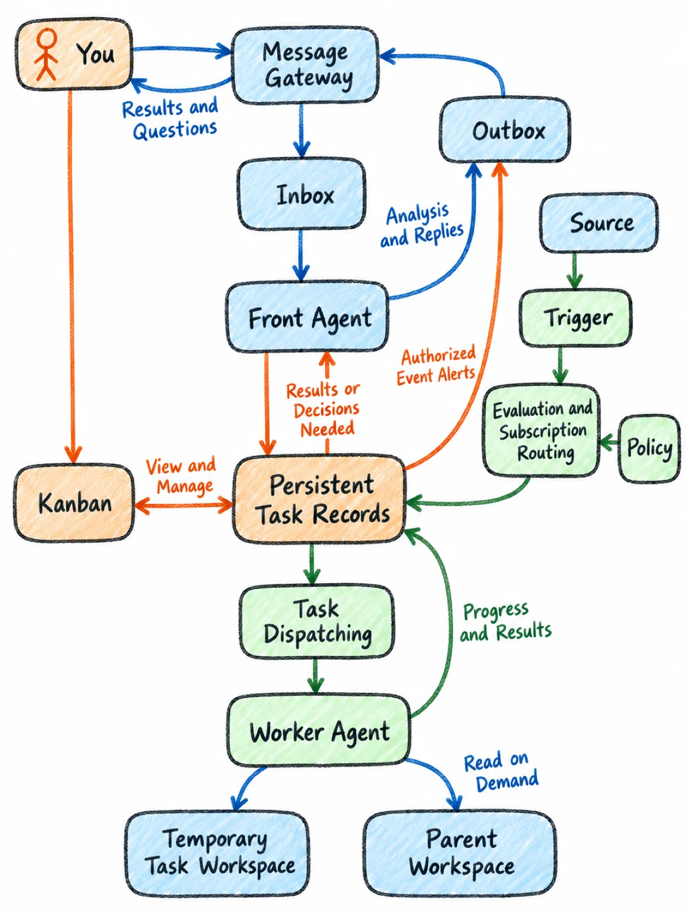
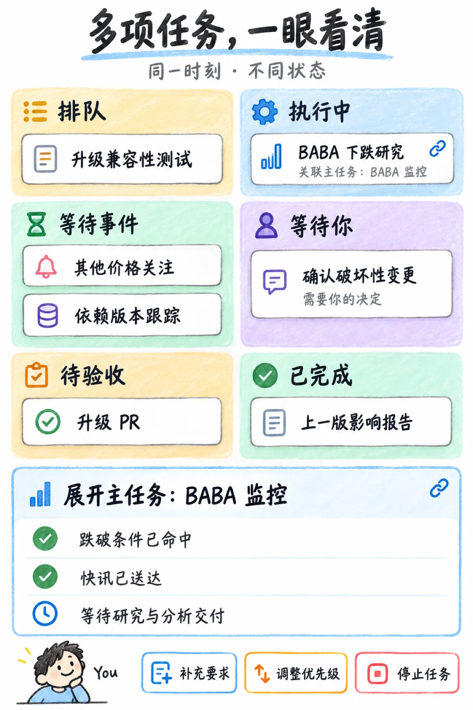

# crayon-diagrams

crayon-diagrams is a Claude Code skill that turns technical article structure into consistent, mobile-readable hand-drawn crayon illustrations — architecture diagrams, process flows, comparison charts, and task-board snapshots — released under the MIT license.

[中文](README.zh-CN.md) · [Examples](examples/) · [Skill](SKILL.md)

<p align="center">
  <a href="examples/personal-agent-architecture/"></a>
  <a href="examples/kanban-snapshot/"></a>
</p>

## Purpose

Asking an image model for an architecture diagram often rewrites the topology, invents arrows, misspells labels, and produces a different style every time. This skill separates the work into a verifiable semantic layer — Mermaid or a content contract — and a nine-block image prompt that locks the canvas, style, exact text, composition, graph, and negative constraints. Style is applied last, after the diagram can already explain the logic.

## Quick start

Install the skill:

```bash
git clone https://github.com/deer-flow/crayon-diagrams.git ~/.claude/skills/crayon-diagrams
```

Then ask Claude Code:

```text
Use crayon-diagrams to draw a mobile-first architecture diagram of a message gateway:
You, Channel, Inbox, Outbox, Front Agent, Worker. Inbox and Outbox belong to
Message Gateway. English labels.
```

Without an image-generation tool, copy `templates/diagram-prompt.md` into any image generator. The skill still produces the semantic layer and the prompt.

## Features

- Semantic layer first: Mermaid or a content contract defines every node, edge, label, and count before any prompt is written.
- Nine-block prompt structure: generator and input, audience, canvas, style, exact-text contract, composition, graph, negative constraints, and revision notes.
- Seven layouts: vertical card flow, status-board snapshot, two-panel comparison, three-row concept comparison, central-spine architecture, topology redraw, and ultra-wide banner.
- Exact-text contracts for Chinese and English labels, including an explicit list of permitted text.
- QA checklist with failure-to-revision phrasing, so local defects are fixed without redrawing the whole image.
- Dependency-free Mermaid outline extractor for flowcharts and sequence diagrams.
- Reusable prompt and revision templates.
- Eight real examples: prompts for all, with Mermaid sources and compressed previews where applicable.
- Generator-agnostic: works with built-in image tools, Gemini or Nano Banana, GPT Image, DeepSeek, Midjourney, and others.

## Install

Personal skill, available in all projects:

```bash
git clone https://github.com/deer-flow/crayon-diagrams.git ~/.claude/skills/crayon-diagrams
```

Project skill, available only in the current repository:

```bash
mkdir -p .claude/skills
git clone https://github.com/deer-flow/crayon-diagrams.git .claude/skills/crayon-diagrams
```

Claude Code discovers `SKILL.md` automatically. For other clients, add the skill folder to their skills directory, or read `SKILL.md` directly.

## Usage

Redraw an existing Mermaid source:

```text
Redraw examples/personal-agent-architecture/source.mmd as a mobile-first crayon
diagram. Keep every node and edge exactly as listed, and reflow the layout.
```

The skill then:

1. Parses the Mermaid source with `scripts/mmd_outline.py` and records node and edge counts.
2. Selects a layout pattern.
3. Fills the nine-block prompt with the exact graph and text contracts.
4. Generates the image, or hands you the prompt file.
5. Runs the QA checklist and writes a delta revision if needed.

Run the parser directly:

```bash
python3 scripts/mmd_outline.py examples/message-gateway/source.mmd
```

**Examples**

| Example | Layout | What it shows |
| --- | --- | --- |
| [personal-agent-architecture](examples/personal-agent-architecture/) | Central-spine architecture | 15 nodes and 20 edges; two generator outputs |
| [message-gateway](examples/message-gateway/) | Topology redraw | 7 nodes and 8 edges; includes a DeepSeek variant |
| [domain-event-flow](examples/domain-event-flow/) | Branch and merge | 8 nodes and 8 edges; ultra-wide LR reflowed to near-square |
| [monitoring-research](examples/monitoring-research/) | Vertical card flow | sequenceDiagram converted to five cards |
| [source-alert-research](examples/source-alert-research/) | Vertical card flow | Prompt only; delivery and research kept separate |
| [kanban-snapshot](examples/kanban-snapshot/) | Status-board snapshot | Six status regions; no arrows between them |
| [human-in-on-loop](examples/human-in-on-loop/) | Two-panel comparison | Solid main path versus dashed supervision path |
| [human-in-on-out-loop](examples/human-in-on-out-loop/) | Three-row concept comparison | in / on / out; human position is the only variable |

## Configuration

No configuration file and no environment variables. Python 3.9+ runs the helper scripts, and the Mermaid parser has no third-party dependencies. Regenerating preview images needs Pillow (`pip install pillow`). Image generation is external: use any tool that accepts a text prompt, or hand the prompt file to the user.

## License

MIT, SPDX identifier `MIT`. Copyright (c) 2026 LofiSu. See [LICENSE](LICENSE).

## Contact

Maintained under the [DeerFlow](https://github.com/deer-flow) organization. The skill was created by Henry. Open an issue for questions, bug reports, or new examples.
