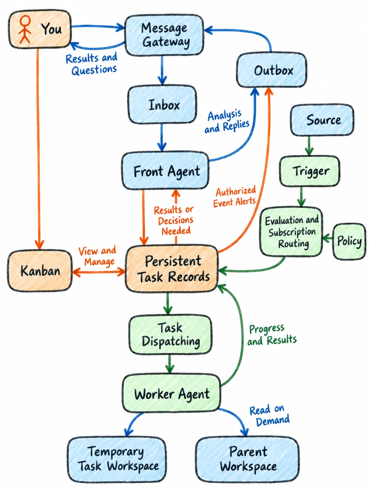

# crayon-diagrams

crayon-diagrams 是一个 Claude Code Skill，把技术文章的结构变成风格统一、手机可读的蜡笔手绘插图：架构图、流程图、对比图和任务看板快照，采用 MIT 许可证。

[English](README.md) · [示例](examples/) · [Skill](SKILL.md)

<p align="center">
  <a href="examples/personal-agent-architecture/"></a>
  <a href="examples/kanban-snapshot/"></a>
</p>

## 用途

直接让图像模型画架构图，常见结果是拓扑被改写、箭头乱连、标签拼错，而且每次风格都不一样。这个 skill 把工作拆成两层：先用 Mermaid 或内容契约写出可校验的语义层，再用九块结构固定画布、风格、精确文本、构图、拓扑和负向约束。风格最后才应用，此时图已经能讲清逻辑。

## 快速开始

安装 skill：

```bash
git clone https://github.com/deer-flow/crayon-diagrams.git ~/.claude/skills/crayon-diagrams
```

然后对 Claude Code 说：

```text
用 crayon-diagrams 画一张手机竖版的消息网关架构图：
You、Channel、Inbox、Outbox、Front Agent、Worker。
Inbox 和 Outbox 属于 Message Gateway。英文标注。
```

没有生图工具时，把 `templates/diagram-prompt.md` 复制到任意图像生成器即可。skill 仍会产出语义层和提示词。

## 功能

- 语义层优先：用 Mermaid 或内容契约先确定每个节点、边、标签和数量，再写提示词。
- 九块提示词结构：生成器与输入、受众、画布、风格、精确文本契约、构图、拓扑、负向约束、修订记录。
- 七种版式：垂直卡片流程、状态看板快照、双面板对照、三行概念对照、中心脊梁架构图、拓扑重绘、超宽横幅。
- 中英文精确文本契约，显式列出允许出现的全部文字。
- QA 检查表与“失败 → 修订”措辞，局部问题不必整张重画。
- 零依赖 Mermaid 解析器，支持流程图和时序图。
- 可复用的生图模板与增量修订模板。
- 8 组真实示例：提示词齐全，部分附 Mermaid 源文件和压缩预览。
- 不绑定生成器：内置生图、Gemini 或 Nano Banana、GPT Image、DeepSeek、Midjourney 均可使用。

## 安装

个人 skill，所有项目可用：

```bash
git clone https://github.com/deer-flow/crayon-diagrams.git ~/.claude/skills/crayon-diagrams
```

项目 skill，只对当前仓库生效：

```bash
mkdir -p .claude/skills
git clone https://github.com/deer-flow/crayon-diagrams.git .claude/skills/crayon-diagrams
```

Claude Code 会自动发现 `SKILL.md`。其他客户端可以把 skill 目录放进各自的 skills 目录，或直接阅读 `SKILL.md`。

## 用法

重绘已有的 Mermaid 源文件：

```text
把 examples/personal-agent-architecture/source.mmd 重绘成手机竖版蜡笔图。
保持所有节点和边不变，重新编排布局。
```

skill 随后会：

1. 用 `scripts/mmd_outline.py` 解析 Mermaid，记录节点数和边数。
2. 选择版式。
3. 用精确的拓扑和文本契约填充九块提示词。
4. 生成图片，或把提示词文件交给你。
5. 执行 QA 检查表，必要时写增量修订。

直接运行解析器：

```bash
python3 scripts/mmd_outline.py examples/message-gateway/source.mmd
```

**示例**

| 示例 | 版式 | 看点 |
| --- | --- | --- |
| [personal-agent-architecture](examples/personal-agent-architecture/) | 中心脊梁架构图 | 15 个节点、20 条边；含两种生成器输出 |
| [message-gateway](examples/message-gateway/) | 拓扑重绘 | 7 个节点、8 条边；含 DeepSeek 变体 |
| [domain-event-flow](examples/domain-event-flow/) | 分支与合流 | 8 个节点、8 条边；超宽 LR 重排为近方形 |
| [monitoring-research](examples/monitoring-research/) | 垂直卡片流程 | 时序图转成 5 张卡片 |
| [source-alert-research](examples/source-alert-research/) | 垂直卡片流程 | 仅有提示词；投递与研究保持分离 |
| [kanban-snapshot](examples/kanban-snapshot/) | 状态看板快照 | 六个状态区；状态之间不画箭头 |
| [human-in-on-loop](examples/human-in-on-loop/) | 双面板对照 | 实线主路径与虚线监督路径 |
| [human-in-on-out-loop](examples/human-in-on-out-loop/) | 三行概念对照 | in / on / out；人的位置是唯一变量 |

## 配置

没有配置文件，也没有环境变量。辅助脚本需要 Python 3.9+，Mermaid 解析器没有第三方依赖。重新生成预览图需要 Pillow（`pip install pillow`）。图像生成在外部完成：使用任何接受文本提示词的工具，或把提示词文件交给用户。

## 许可证

MIT，SPDX 标识符 `MIT`。Copyright (c) 2026 Henry Li。详见 [LICENSE](LICENSE)。

## 联系

由 [DeerFlow](https://github.com/deer-flow) 组织维护，由 [Henry Li](https://github.com/magiccube) 创建。问题、缺陷和新示例请提交 Issue。
